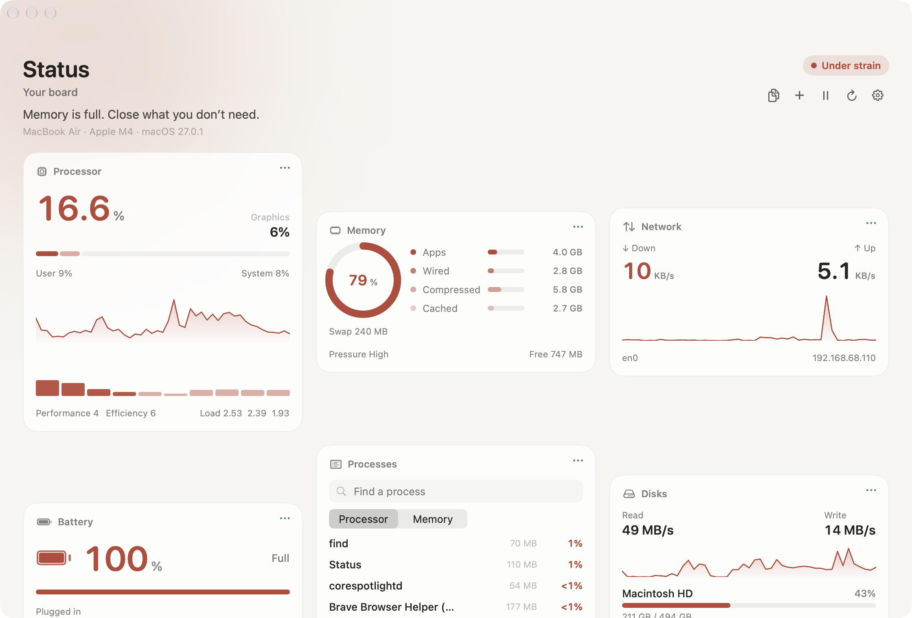
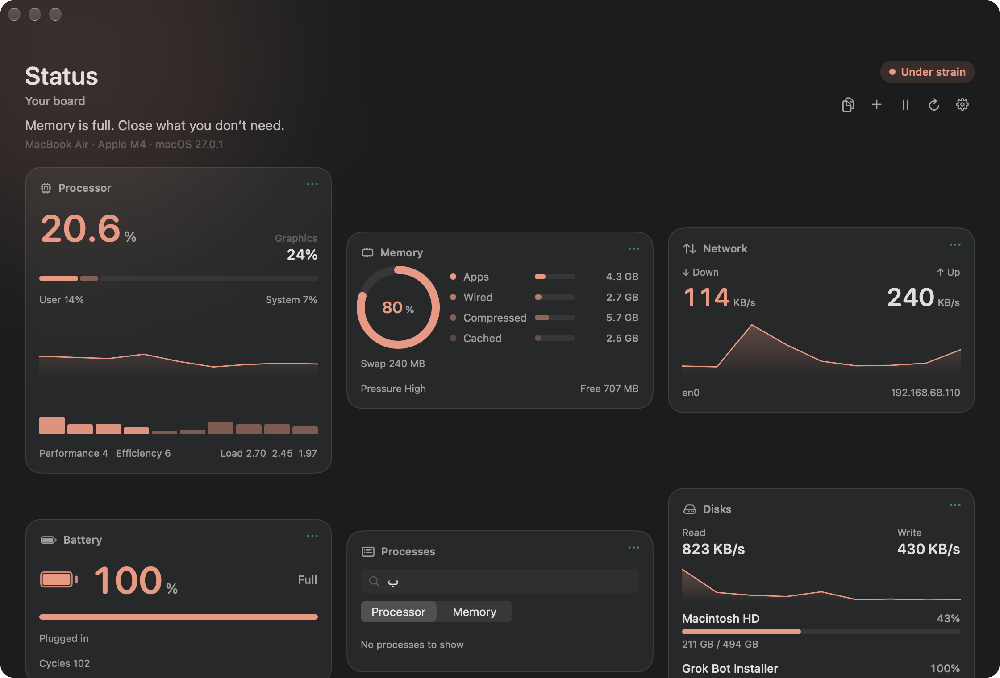
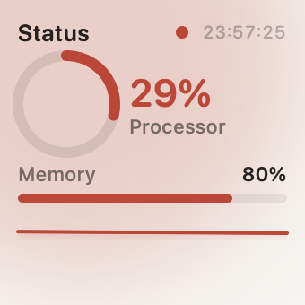
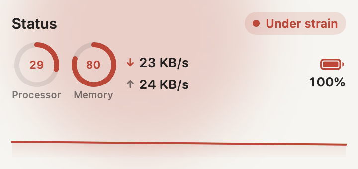
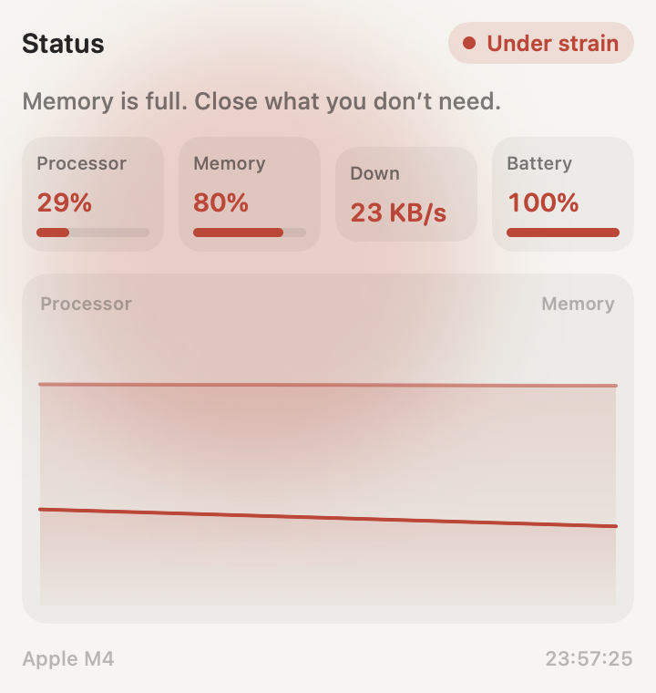
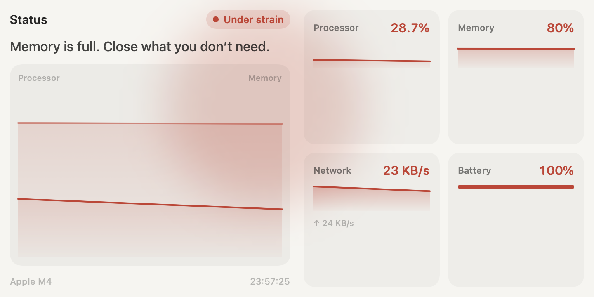

# Status

تطبيق لماك يجلس في شريط القائمة ويقرأ الجهاز بهدوء. تضغط الأيقونة في الأعلى فتنفتح حالة المعالج والذاكرة والشبكة والبطارية، وإذا أردت الصورة كاملة تفتح اللوحة. وتقدر تضيفه ويدجت على سطح المكتب بالأحجام الأربعة.

الأرقام من جهازك، على جهازك. ما يرسل شيء لسيرفر، وما يحتاج حساب.

<p align="center" dir="ltr">
  <a href="../../README.md"></a>
  <a href="./README.ar.md"></a>
  <a href="./README.fr.md"></a>
  <a href="./README.es.md"></a>
  <a href="./README.de.md"></a>
  <a href="./README.tr.md"></a>
</p>

## التحميل

ما تحتاج Xcode، ولا سطر أوامر.

1. نزّل [Status.zip](https://github.com/0xx9/Status/releases/latest/download/Status.zip).
2. اضغط الضغطتين على الملف. يطلع تطبيق **Status**.
3. اسحب **Status** إلى **Applications**.
4. أول مرة: اضغط Control على **Status** واختر **Open**، ثم **Open** مرة ثانية. macOS يسأل مرة واحدة لأن النسخة مو من المتجر.

بعدها يبقى في شريط القائمة. اضغط الأيقونة.

<p align="center">
  
</p>

## ماذا ترى

اللوحة ليست قائمة أرقام. كل أداة لها وجه: حلقة، مخطط، وحالة.

- **المعالج.** النسبة الآن، حصة المستخدم والنظام، نوى الأداء ونوى الكفاءة، والحِمل لآخر دقيقة وخمس دقائق وخمس عشرة دقيقة. إذا وُجدت قراءة للرسوم، تظهر بجانبه.
- **الذاكرة.** التطبيقات، الذاكرة المثبتة، المضغوطة، والمخزّنة مؤقتًا، مع الضغط والمبادلة والمتاح.
- **الشبكة.** النزول والطلوع على الواجهة الحقيقية، مع العنوان والمخطط. واجهات النظام الداخلية لا تُحسب.
- **البطارية.** الشحن أو الوقت المتبقي، الدورات، والحرارة حين تتوفر.
- **الأقراص.** القراءة والكتابة، والمساحة المستخدمة على كل قرص.
- **العمليات.** أثقل ما يعمل الآن، بالبحث، مرتبة حسب المعالج أو الذاكرة.
- **الجهاز.** الشريحة، النظام، ومدة التشغيل، وحالة الحرارة.

فوق اللوحة جملة واحدة تقول ما الذي يستحق انتباهك: هادئ، يعمل، تحت ضغط، حار، أو البطارية منخفضة.

<p align="center">
  
</p>

## شريط القائمة

النقرة اليسرى تفتح اللوحة الصغيرة. النقرة اليمنى قائمة: إيقاف المراقبة، تحديث، التفاصيل، الإعدادات، والخروج.

تختار ماذا يظهر بجانب الأيقونة: المعالج، الذاكرة، الشبكة، أو البطارية، حتى ثلاثة معًا. إذا اخترت مقياسًا واحدًا، يظهر خط صغير بدل الرقم.

المراقبة تعمل وحدها. تقدر توقفها، أو تخليها ألطف على البطارية ووضع الطاقة المنخفضة. سرعة التحديث: كل ثانية، أو كل ثانيتين، أو كل خمس ثوانٍ.

التنبيه يصل إذا المعالج أو الذاكرة أو الحرارة تجاوزت الحد الذي ضبطته. أول لحظات بعد التشغيل صامتة، حتى لا يزعجك التطبيق وهو يصحو.

التشغيل مع تسجيل الدخول من الإعدادات. على بناء موقّع محليًا قد يطلب macOS موافقتك مرة من إعدادات النظام.

## الويدجت

أربعة أحجام: صغير، متوسط، كبير، وكبير جدًا. نفس اللوحة: حلقة المعالج، الذاكرة، الشبكة، البطارية، ومخطط آخر القراءات. الساعة على الوجه هي وقت آخر قراءة، فإذا تحركت فالأرقام جديدة.

الويدجت يقرأ الحالة التي يكتبها التطبيق، لذلك يطابق شريط القائمة ولا يقيس الجهاز قراءة ناقصة. إذا كان التطبيق متوقفًا، يقيس بنفسه.

<p align="center">
  
  &nbsp;&nbsp;
  
</p>

<p align="center">
  
  &nbsp;&nbsp;
  
</p>

بعد تثبيت نسخة جديدة، احذف الويدجت القديم من سطح المكتب وأضفه مرة أخرى. macOS يربط الويدجت بنسخة التطبيق التي أضفته منها.

## اللغة

التطبيق يتبع لغة النظام. إذا كانت العربية، الواجهة من اليمين لليسار والأرقام تبقى في مكانها. ومن الإعدادات تبدّل بين العربية والإنجليزية متى شئت.

صفحات هذا المستودع مستقلة. الأزرار في الأعلى تفتح الشرح نفسه بالإنجليزية والفرنسية والإسبانية والألمانية والتركية.

## البناء

فقط إذا تبي تترجمه بنفسك. التحميل فوق هو التطبيق. يحتاج macOS 15 و Xcode 16 أو أحدث.

```bash
git clone https://github.com/0xx9/Status.git
cd Status
xcodebuild -project Status.xcodeproj -scheme Status -destination 'platform=macOS' -configuration Release build
open ~/Library/Developer/Xcode/DerivedData/Status-*/Build/Products/Release/Status.app
```

أو افتح `Status.xcodeproj` واضغط تشغيل.

التطبيق نفسه غير معزول، لأن قراءة العمليات والأقراص والشبكة تحتاج ذلك. امتداد الويدجت معزول، ويقرأ ملف الحالة الذي يكتبه التطبيق داخل حاويته.

## ما بداخل المشروع

| المجلد | دوره |
| --- | --- |
| `Status` | شريط القائمة، اللوحة، الإعدادات، والتنبيهات |
| `StatusWidgets` | ويدجت macOS |
| `Shared` | القياس، الحساب، التنسيق، والترجمة |
| `StatusTests` | اختبارات الحساب والتنسيق وعينة حية من الجهاز |
| `tools` | رسم أيقونة التطبيق |

الإصدار 1.0. المعرّف `com.muhsan.status`.
